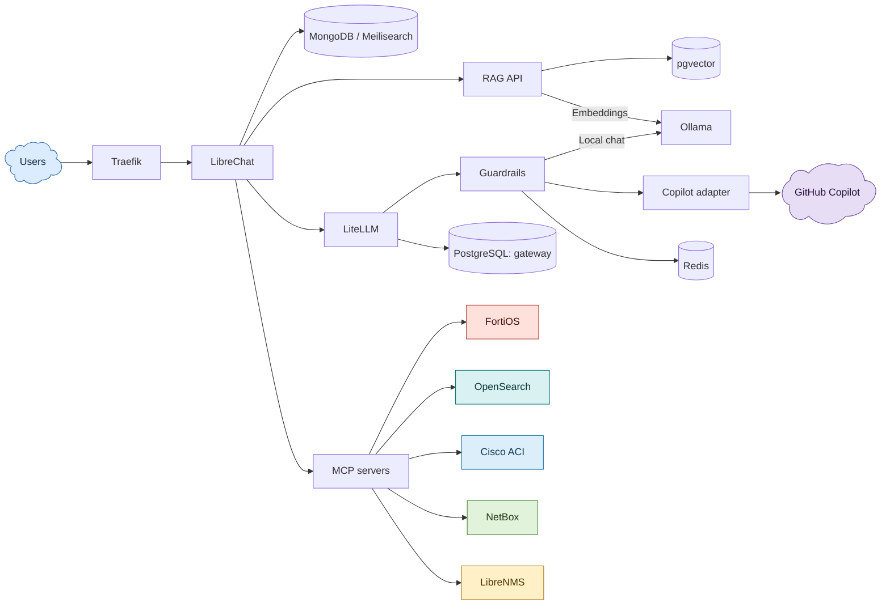

# Network Helper MCP cluster

LibreChat is the chat portal. Its OpenAI-compatible endpoint is LiteLLM, which routes requests to GitHub Copilot or the existing Ollama service. Presidio and the stable-mask guardrail run in LiteLLM before cloud requests leave the network. The MCP services remain separate and are only reachable by LibreChat.

| Service | Host port | Purpose |
|---|---:|---|
| Traefik | 443 | Connects users securely to the portal and manages HTTPS certificates |
| LibreChat | internal | Lets users sign in, chat with models, and use network tools |
| LiteLLM | not published | Routes chat requests to the selected model and applies data-protection rules |
| Copilot adapter | not published | Connects the model gateway to GitHub Copilot |
| MongoDB, Meilisearch, RAG API, pgvector | not published | Store accounts and chats, make chat history searchable, and help answer questions using uploaded documents |
| LiteLLM PostgreSQL | not published | Stores gateway settings and access keys |
| Redis, Presidio analyzer/anonymizer | not published | Help mask sensitive information and restore masked IP addresses in responses |
| Ollama | external | Runs local chat and document-search models |
| MCP servers | not published | Give agents access to firewall, log, fabric, inventory, and monitoring information |

Cisco ISE is disabled in the Compose file, so it is not configured as a LibreChat MCP server.

## Architecture



## Network and tool policy

Each MCP service remains on its own network. LibreChat joins those networks and a client network shared with LiteLLM. The Copilot adapter, Redis, and Presidio are on a separate upstream network that LibreChat cannot reach; only LiteLLM joins both. LiteLLM's PostgreSQL database is on a separate internal network shared only with LiteLLM, independent of the LibreChat RAG database. MCP servers are hidden from ordinary chat and are available through Agents. Across all agents, LibreChat automatically approves FortiOS, Cisco ACI, and LibreNMS catalog searches and the four direct FortiOS retrieval tools. Other calls require approval, including `call_tool`, which can invoke writes.

The MCP catalog is compact for LibreChat. FortiOS exposes generic CMDB, monitor, and log retrieval tools, plus `search_tools` and `call_tool` for its full catalog. Cisco ACI and LibreNMS also use `search_tools` and `call_tool`: search for an operation, then invoke it with the returned name and arguments. LibreNMS remains in read-only mode; FortiOS and ACI search can find write operations. OpenSearch and NetBox retain their existing tools. This reduces tool definitions sent to the model, but requires a model that can search and call tools in multiple steps.

For examples of additional named MCP instances, see [Compose examples](examples/README.md).

By default, LiteLLM and the Copilot adapter reject Copilot requests containing tools or tool results. To allow Copilot to use MCP, explicitly set `ALLOW_COPILOT_MCP=true` in `.env` and recreate LiteLLM and the Copilot adapter. Tool definitions, arguments, and results can then be sent to GitHub Copilot; the configured masking guardrails are not a guarantee that all sensitive network information is removed. Other cloud models remain blocked from MCP. The local Ollama model can use MCP without this opt-in.

Cloud model requests pass through the Presidio and stable-mask guardrails. Names, email addresses, and phone numbers are masked; credit-card detections are blocked. IP addresses use stable HMAC-derived placeholders stored in authenticated Redis, so the same address maps to the same placeholder across requests. Treat the HMAC and Redis secrets as durable data keys and back up Redis with the databases.

## Network Context

The Markdown files in [network-context/](network-context/) provide optional device-specific background for each MCP server: its role, relationships, and operational guidance. Edit the matching file to replace the placeholders with accurate information. At startup, Compose generates the LibreChat configuration with each file as instructions for its corresponding MCP server. The instructions are included when that server's tools are available to an agent; they do not enforce permissions or guarantee that an agent follows them.

These files are tracked in Git and their contents can be sent to the selected model, including GitHub Copilot. Do not include passwords, tokens, private keys, or network details that should not be committed or shared with that model. Keep instructions concise and review changes as carefully as code.

After changing a context file or [librechat.yaml](librechat/librechat.yaml), regenerate the configuration and recreate LibreChat:

```sh
docker compose run --rm --no-deps librechat-context-init
docker compose up -d --no-deps --force-recreate librechat
```

For Podman, use `-f compose.yaml -f compose.podman.yaml` with both commands. Startup fails if a required context file is missing, empty, or larger than 64 KiB. When using additional overlays, include the same files on both commands so LibreChat keeps their networks and settings.

## Setup

1. Copy the template if `.env` does not already exist. If you have an existing `.env`, update it carefully rather than overwriting it:

   ```sh
   cp .env.example .env
   ```

2. Replace the placeholders needed by your selected authentication mode in `.env`. Generate independent secrets with `openssl rand -hex 32`; use 16 random bytes for `CREDS_IV`. Keep the `.env` file private.
   The internal MongoDB and RAG PostgreSQL users and RAG database are fixed to `librechat` in Compose. Existing `.env` entries `MONGO_ROOT_USERNAME`, `POSTGRES_USER`, and `POSTGRES_DB` are ignored. If reusing database volumes created with different values, migrate their users/database before starting; initialization settings do not rename existing data. External service usernames must still match those systems.
3. Configure Copilot authentication. For individual testing, set `COPILOT_AUTH_MODE=token` and `COPILOT_GITHUB_TOKEN` to your existing valid GitHub token in `.env`. This mode uses one person's identity and is not appropriate for a shared portal; check your GitHub terms and organization policy. The token must be valid for Copilot; classic `ghp_` personal access tokens are not supported by the Copilot SDK.

   For organization-billed use, set `COPILOT_AUTH_MODE=github_app` and configure the GitHub App:
   - Grant the organization-level **Copilot Requests** permission as read-only.
   - Install the app in the organization that should be billed.
   - Enable GitHub App installation authentication for Copilot in that organization.
   - Set its app ID and installation ID in `.env`; base64-encode its complete PEM private key into `COPILOT_APP_PRIVATE_KEY_B64` (for example, `base64 -w 0 private-key.pem`).

   The adapter mints and refreshes one-hour installation tokens automatically. Copilot usage is attributed and billed to the GitHub organization. See the [GitHub App setup guide](copilot-adapter/GITHUB_APP.md).
4. Configure HTTPS ingress: set `LIBRECHAT_HOSTNAME` to a public DNS name pointing to this host and set `TRAEFIK_ACME_EMAIL`. Compose derives both LibreChat URLs as `https://<hostname>`; any existing `DOMAIN_CLIENT` and `DOMAIN_SERVER` entries in `.env` are ignored. Set `ACME_DNS_API_BASE` and `ACME_DNS_ACCOUNT_FILE`, then generate the ACME-DNS account file (do not commit it):

   ```sh
   python3 scripts/register_acme_dns.py \
     --domain chat.example.com \
     --server-url https://auth.example.com \
     --output /data/certs/acme-dns-account.chat.example.com.json
   ```

   Replace the example values above with the ones set in `.env`. The command sends a registration request to the ACME-DNS server and stores its response as a domain-keyed JSON file with mode `0600`. Have your DNS administrator create the `_acme-challenge.<hostname>` CNAME pointing to the generated `fulldomain`; DNS-provider changes are outside this Compose setup. Allow inbound TCP port 443. Traefik uses the Let's Encrypt DNS-01 challenge with recursive resolvers `8.8.8.8` and `1.1.1.1` and persists certificates in its named volume; HTTP port 80 is not published. Traefik's propagation checks may also require access to authoritative DNS servers.
5. Local email/password login is enabled by default; public email registration stays disabled. Once LibreChat is running, create a local account interactively:

   ```sh
   docker compose exec librechat npm run create-user
   ```

   Use a strong password; the script displays typed input in the terminal, so keep the screen private. To enable Microsoft Entra later, configure the OIDC settings, register `https://<LIBRECHAT_HOSTNAME>/oauth/openid/callback` as the redirect URI, and set `ALLOW_SOCIAL_LOGIN=true`. Set `ALLOW_EMAIL_LOGIN=false` if local login should then be disabled. Recreate LibreChat to apply changes.
6. Point `OLLAMA_BASE_URL` and `OLLAMA_API_BASE_URL` at the Ollama service already available to your network. This repository does not start an Ollama container. The example uses `qwen3-coder:latest` for chat and `nomic-embed-text` for RAG embeddings; pull them on the Ollama host if needed.

The LibreChat endpoints use a LiteLLM virtual key, separate from the gateway master key. `litellm-key-init` creates that restricted key automatically and stops if an existing key has unexpected model permissions.

## Start

Ensure TCP port 443 is available and the configured public hostname resolves to this host. For Podman, set `TRAEFIK_DOCKER_SOCKET` to the running Docker-compatible Podman socket.

An existing Open WebUI container is no longer managed by this configuration and may remain running as a Compose orphan. Stop and remove it separately when ready; preserve or back up its data volume if its chat history is needed.

The master [compose.yaml](compose.yaml) includes [compose.mcp.yaml](compose.mcp.yaml), so the MCP services start with the rest of the stack:

```sh
docker compose up -d --build
docker compose ps
docker compose logs -f traefik librechat litellm copilot-adapter
```

For Podman, add the isolation override:

```sh
podman compose -f compose.yaml -f compose.podman.yaml up -d --build
```

To add another MCP instance, edit [compose.mcp.yaml](compose.mcp.yaml), configure its credentials and LibreChat entry, and add its context file. See [Compose examples](examples/README.md) for templates and details.

Check `docker compose logs litellm-key-init` if LibreChat cannot authenticate to the model gateway. LibreChat chat history is stored in its own named volumes; Open WebUI history is not migrated.

## Validation

The tests need Python with PyYAML and Docker Compose or Podman Compose. The Compose tests render both configurations using `.env.example` and do not start services:

```sh
python3 -m unittest discover -s tests -v
docker compose --env-file .env.example config --quiet
```

Check the compact MCP catalogs without connecting to network devices:

```sh
docker compose build fortios-mcp cisco-aci-mcp
docker run --rm --network none --entrypoint python -v "$PWD/mcp/fortigate/test_catalog.py:/app/test_catalog.py:ro" fortios-mcp:local /app/test_catalog.py -v
docker run --rm --network none --entrypoint python -v "$PWD/mcp/cisco-aci/test_catalog.py:/app/test_catalog.py:ro" cisco-aci-mcp:local /app/test_catalog.py -v
```

Build and run the Copilot adapter's offline tests:

```sh
docker compose build copilot-adapter
docker compose run --rm --entrypoint python copilot-adapter -m unittest -v test_main
```

The existing MCP health checks verify only that each server responds to an MCP initialize request; they do not verify upstream credentials or device access. Tool search is not a security boundary: FortiOS, ACI, and OpenSearch can expose write operations. Use appropriately scoped upstream credentials, including a read-only FortiGate account when only retrieval is intended, and review each tool call before approving it, including the operation and arguments inside `call_tool`.

## Project layout

```text
compose.yaml              Main cluster definition, including MCP services
compose.mcp.yaml          Included MCP services and networks
compose.podman.yaml       Podman network-isolation override
librechat/librechat.yaml  LibreChat endpoints, MCP servers, and approvals
mcp/                      MCP server builds and integrations
examples/                 Compose templates for additional MCP instances
network-context/          Per-server network context for agents
copilot-adapter/          Copilot SDK to OpenAI-compatible HTTP adapter
litellm/                  Model routing and MCP access policy
new design/stable_mask.py Stable IP placeholders for LiteLLM
tests/                    Compose and model/tool-policy tests
```